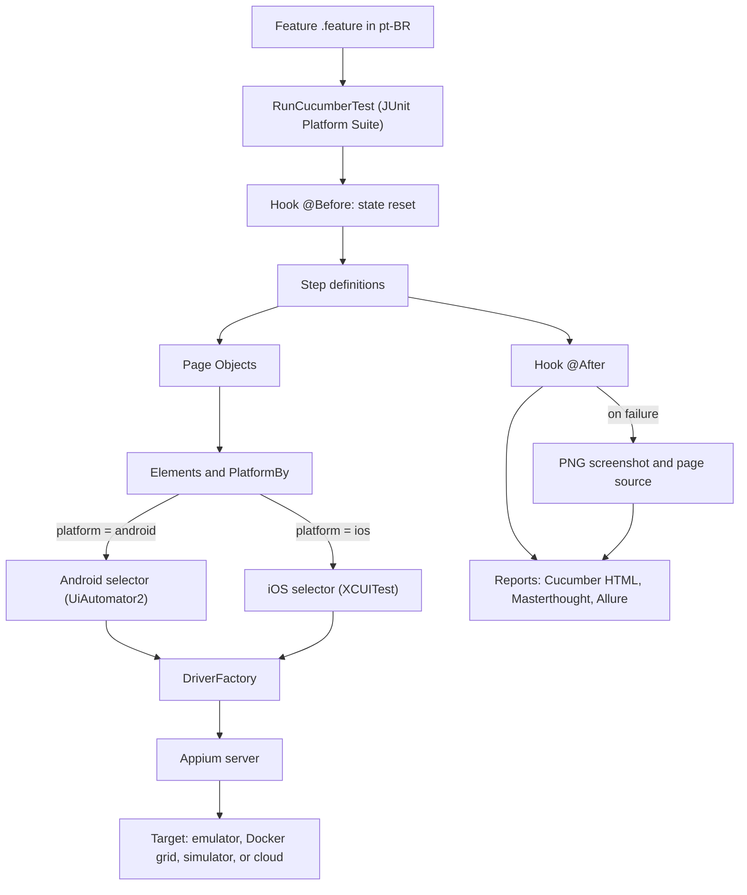
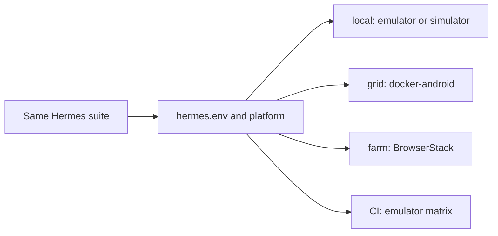

# Hermes

[Português](README.md) · **English**

### Overview

Hermes is an end-to-end test automation framework for mobile applications. The same suite of scenarios, written in business language (Gherkin), runs on Android and iOS without code duplication: only the selectors differ between platforms, and that divergence is isolated in a single layer. The execution target (local emulator, container grid, or cloud device farm) is treated as configuration, never as a code change.

The project was designed to reflect real market practices in mobile automation and to be fully verifiable: everything this document states can be checked in the public continuous integration runs and in the published report.

### What this project demonstrates

1. One suite, two platforms. The same Gherkin scenarios drive Android (UiAutomator2 driver) and iOS (XCUITest driver) from shared features, steps, and page objects. Only the selectors change, resolved per platform through the `PlatformBy` class. The full 21-scenario suite is verified green on the Android emulator matrix; the smoke suite, including the full end-to-end checkout, is verified green on the iOS simulator.
2. BDD with Cucumber. There are 21 scenarios (counting Scenario Outline expansions) across five features: login, catalog, product details, cart, and full checkout. Scenario Outline with example tables is used where it fits.
3. Page Objects with composition. Each screen has a page (behavior) backed by an elements class (selectors only). The `NavBar` navigation component is shared by composition, not by inheritance.
4. Reusable, parameterized steps. Cucumber expressions such as `o usuário adiciona o produto {int} ao carrinho` keep the step vocabulary small and composable across features.
5. Deterministic state reset. Before every scenario the app state is reset (on Android by clearing the app data; on iOS through the documented header-logo long-press), keeping scenarios fully independent and always logged out.
6. Modern native gestures. Long-press and scroll are implemented with platform-specific `mobile:` commands. The legacy TouchAction API is not used.
7. Explicit waits only. Synchronization is done exclusively with WebDriverWait. There is no Thread.sleep anywhere in the codebase.
8. Failure evidence. A Cucumber hook captures, on each failure, a PNG screenshot and the page source, attaching the screenshot to the Allure report. The page source was the tool that allowed porting the selectors to iOS precisely.
9. Continuous integration on real devices and containers. GitHub Actions runs the suite on a matrix of Android emulators (with KVM acceleration), on a containerized docker-android grid, and on an iOS simulator on a macOS runner.

### Technical stack

| Component | Version |
| --- | --- |
| Java | 21 (Temurin) |
| Maven | 3.9 |
| Appium java-client | 9.5.0 |
| Selenium | 4.34.0 (pinned) |
| JUnit 5 (Platform Suite) | 5.14.4 |
| Cucumber JVM | 7.34.3 |
| Allure (cucumber7-jvm) | 2.35.2 |
| Masterthought (maven-cucumber-reporting) | 5.11.0 |

### Architecture

```
src/test/java/io/hermes/
  core/        Config, Platform, DriverFactory, DriverManager, Gestures, NativeDialogs
  elements/    One selector class per screen, plus PlatformBy (per-platform resolution)
  pages/       Page objects: Login, Catalog, Product, Cart, Checkout (Address, Payment,
    |          Review, Complete) with actions and assertion helpers
    components/  NavBar (header and navigation), shared by composition
  model/       Test data: User, Address, PaymentCard
  steps/       Hooks plus step definitions (pt-BR) per feature
  RunCucumberTest.java   JUnit Platform Suite runner

src/test/resources/
  features/    login, catalog, product, cart, checkout (.feature, pt-BR)
  config/      local.properties, grid.properties, farm.properties (execution profiles)
```

The four-layer separation (elements, pages, steps, and features) keeps each responsibility isolated. When a selector changes in the app, there is a single place to fix. When a business flow changes, the feature and the steps reflect it without touching the selectors.

### How it works (execution flow)

The diagram below shows the path of a scenario, from the Gherkin file to the report. The key idea is that the elements layer resolves the correct selector per platform and the driver factory decides between Android and iOS, while features, steps, and pages stay the same.



The same test suite points to different targets by configuration alone, without changing a single line of code:



### Cross-platform support

The core is platform-agnostic. The `DriverFactory` creates an `AndroidDriver` or an `IOSDriver` according to the `platform` configuration, and everything else works with the `AppiumDriver` abstraction. Where Android and iOS genuinely diverge, resolution happens at controlled points:

| Aspect | Android | iOS |
| --- | --- | --- |
| Main navigation | side drawer (hamburger) | bottom tab bar |
| Open menu | selector `open menu` | selector `tab bar option menu` |
| Cart | selector `cart badge` | selector `tab bar option cart` |
| Catalog items | container `store item` | text `store item text` (the cell collapses on iOS) |
| Text keyboard | native dismissal | tap the Return key |
| Numeric keyboard | native dismissal | tap the neutral header |
| State reset | clear app data | documented long-press |

These differences were discovered by reading the real page source captured on CI failures, not by guessing. One detail illustrates the value of testing on both platforms: the card number used originally passed on Android but was rejected by Luhn validation on iOS, which only became evident when running the same suite on the simulator.

### Covered scenarios

Login: a valid login lands on the catalog; rejected credentials show an error message (Scenario Outline with an invalid user and a locked-out user); required-field validation; logout ends the session.

Catalog: products are listed on launch; product details show price and the add-to-cart button; sorting by name and by price, ascending and descending (Scenario Outline).

Product: the quantity counter increases and decreases; adding to the cart with a quantity greater than one.

Cart: adding a product fills the cart; adding two distinct products; removing the only item empties the cart; an empty cart leads back to shopping.

Checkout: full end-to-end purchase (address, payment, review, and completion); checkout requires authentication; payment without a card number is blocked.

### Running locally

Prerequisites: JDK 21, Maven, Node.js, Android SDK with an emulator (or a physical device), and Appium 2 with the UiAutomator2 driver.

```
npm install -g appium@2.19.0
appium driver install uiautomator2@4.2.9
```

Steps:

```
# 1. Download the pinned APK into apps/ (gitignored)
bash scripts/download-app.sh

# 2. Start an emulator and the Appium server
appium

# 3. Run the full suite
mvn test

# Only the smoke subset
mvn test -Dgroups=smoke

# Validate step bindings without a device
mvn test -Dcucumber.execution.dry-run=true
```

In Eclipse or IntelliJ, run the `RunCucumberTest` class as a JUnit test.

### Reports

There are three reports, each with a distinct role:

| Report | When it is produced | Where |
| --- | --- | --- |
| Cucumber HTML (instant evidence) | every run, including in the IDE | `target/cucumber-report/cucumber.html` |
| Masterthought (rich HTML, charts per feature, tag, and step) | on `mvn verify` and on CI | `target/cucumber-html-reports/overview-features.html` |
| Allure (deep analysis, attachments, run history) | `mvn allure:serve` locally; published to GitHub Pages by CI | `target/allure-results` and the published page |

```
mvn verify          # runs the suite and builds the Masterthought report
mvn allure:serve    # builds and opens the Allure report
```

Failing scenarios include the screenshot as an attachment in the reports.

### Continuous integration

The main CI workflow ([mobile-tests.yml](.github/workflows/mobile-tests.yml)) has three jobs:

1. Compile gate. Runs `mvn test-compile` and a Cucumber dry-run to fail early on broken code or an unbound step.
2. Device-matrix E2E. Enables KVM and runs the suite on a matrix of emulators (API 30 with the pixel_4 profile and API 33 with the pixel_6 profile): the same code on different devices. Allure results are always uploaded as artifacts; screenshots and the Appium log are uploaded on failure.
3. Report. Merges the Allure results from all devices and publishes the report, with run history, to GitHub Pages.

Runs can also be triggered manually from the Actions tab (workflow_dispatch), choosing the test subset.

Additional workflows:

* [ios-tests.yml](.github/workflows/ios-tests.yml) runs the smoke suite on an iPhone simulator on a macOS runner (free for public repositories), including the end-to-end checkout.
* [grid-smoke.yml](.github/workflows/grid-smoke.yml) validates the docker-android grid using the KVM available on ubuntu runners.
* [farm-tests.yml](.github/workflows/farm-tests.yml) runs the suite on real devices on BrowserStack App Automate (requires credentials configured as repository secrets).

### Docker grid (local device farm)

The [docker/](docker/README.md) folder ships a compose file that boots multiple containerized emulators with different device profiles (docker-android), with noVNC viewing in the browser and one Appium server per container. The requirement is a Linux host with KVM. It does not work on Windows or macOS hosts; the details are in the folder README. The grid smoke workflow validates this scenario using the KVM on ubuntu runners.

### Configuration and execution profiles

The suite never knows where it runs. The profile is chosen with `-Dhermes.env=<name>` (or the `HERMES_ENV` variable), loading `src/test/resources/config/<name>.properties`:

| Profile | Target |
| --- | --- |
| local (default) | emulator or device with Appium on this machine |
| grid | containerized devices (docker-android, Linux hosts with KVM) |
| farm | cloud device farm (BrowserStack App Automate shape; credentials only through environment variables) |

Every key can be overridden per run, with the precedence: system property, then environment variable, then profile file, then default.

| Key (`-D`) | Environment variable | Default | Description |
| --- | --- | --- | --- |
| `platform` | `PLATFORM` | `android` | `android` or `ios` |
| `appium.url` | `APPIUM_URL` | `http://127.0.0.1:4723` | Appium server, grid, or cloud URL |
| `app.path` | `APP_PATH` | APK path | app path, or cloud app id |
| `device.name` | `DEVICE_NAME` | `Android Emulator` or `iPhone 15` | device name |
| `timeout.default` | `TIMEOUT_DEFAULT` | `15` | explicit-wait timeout in seconds; CI uses 30 |
| `timeout.short` | `TIMEOUT_SHORT` | `5` | probe timeout in seconds; CI uses 10 |

Profiles can also declare provider-specific capabilities with the `capability.` prefix (for example `capability.appium:platformVersion=13.0`), forwarded as-is by the `DriverFactory`. Integrating a new grid or cloud requires no code change.

### Roadmap

The architecture principles and project phases are in [ROADMAP.md](ROADMAP.md). The core phases are complete and green. The documented next steps are: full iOS regression parity, activation of the BrowserStack cloud profile, and observability integration with ReportPortal.

### Disclaimer

This is a personal and independent project, built for study and portfolio purposes. It does not represent, is not associated with, and does not reflect the position of any company, employer, or organization. Any third-party trademarks, products, or names that may be cited belong to their respective owners and are mentioned only for descriptive and technical interoperability purposes, without any affiliation, sponsorship, or endorsement.

The application used as a test target belongs to its respective owner and is used solely as a public automation target, without redistribution, modification, or version control of its binaries in this repository. This framework code is distributed under the MIT license; the dependencies follow their respective licenses. The software is provided as is, without warranties of any kind.

### License

[MIT](LICENSE)

[Compatibility and execution evidence](docs/COMPATIBILITY.md)

[Versioning and release validation](docs/RELEASING.md)
