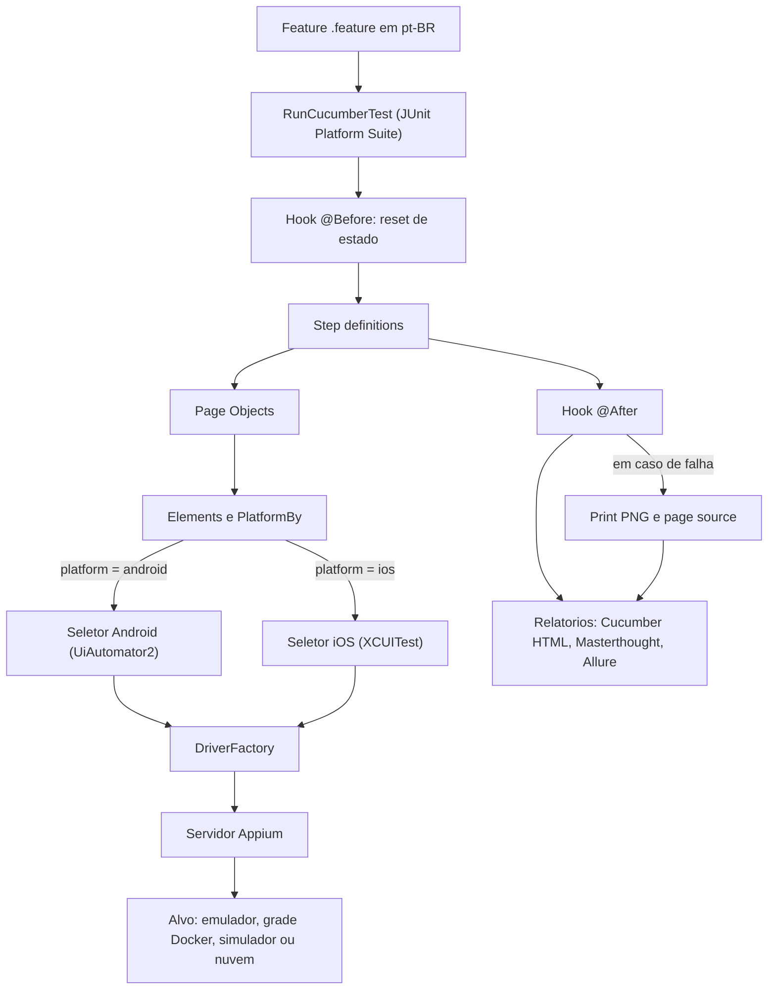
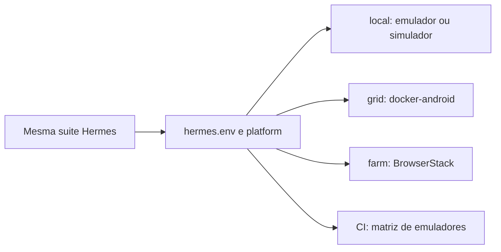

# Hermes

[](https://github.com/JonnasFigueiredo/Hermes/actions/workflows/mobile-tests.yml)


Framework de testes E2E mobile multiplataforma (Android e iOS) construído com Appium 2, Java 21, Maven, Cucumber (BDD) e JUnit 5, com geração de relatórios em Allure, Masterthought e HTML nativo do Cucumber. O aplicativo sob teste é o [Sauce Labs My Demo App RN](https://github.com/saucelabs/my-demo-app-rn) na versão 1.3.0 (build fixado por versão). Os cenários Gherkin são escritos em português do Brasil (`# language: pt`).

**Português** · [English](README.en.md)

Relatório Allure publicado: https://jonnasfigueiredo.github.io/Hermes/

### Visão geral

Hermes é um framework de automação de testes de ponta a ponta para aplicativos mobile. A mesma suíte de cenários, escrita em linguagem de negócio (Gherkin), é executada em Android e iOS sem duplicação de código: apenas os seletores divergem entre as plataformas, e essa divergência fica isolada em uma única camada. O alvo de execução (emulador local, grade de containers ou nuvem de dispositivos) é tratado como configuração, nunca como alteração de código.

O projeto foi desenhado para refletir práticas reais de mercado em automação mobile e para ser totalmente verificável: tudo o que este documento afirma pode ser conferido nas execuções públicas de integração contínua e no relatório publicado.

### O que o projeto demonstra

1. Uma suíte, duas plataformas. Os mesmos cenários Gherkin guiam Android (driver UiAutomator2) e iOS (driver XCUITest) a partir de features, steps e page objects compartilhados. Somente os seletores mudam, resolvidos por plataforma através da classe `PlatformBy`. A suíte completa de 21 cenários é verificada verde na matriz de emuladores Android; a suíte de smoke, incluindo o fluxo de compra de ponta a ponta, é verificada verde no simulador iOS.
2. BDD com Cucumber. São 21 cenários (contando as expansões de Esquema de Cenário) distribuídos em cinco features: login, catálogo, detalhes do produto, carrinho e checkout completo. Há uso de Esquema de Cenário com tabelas de exemplos.
3. Page Objects com composição. Cada tela tem uma página (comportamento) apoiada por uma classe de elementos (somente seletores). O componente de navegação `NavBar` é compartilhado por composição, e não por herança.
4. Steps reutilizáveis e parametrizados. Expressões do Cucumber como `o usuário adiciona o produto {int} ao carrinho` mantêm um vocabulário pequeno e combinável entre as features.
5. Reset de estado determinístico. Antes de cada cenário o estado do aplicativo é zerado (no Android, limpando os dados do app; no iOS, pela função documentada de long-press no logo do cabeçalho), garantindo cenários totalmente independentes e sempre deslogados.
6. Gestos nativos modernos. Long-press e rolagem são implementados com comandos `mobile:` específicos de cada plataforma. Não há uso da API legada TouchAction.
7. Apenas esperas explícitas. A sincronização é feita exclusivamente com WebDriverWait. Não existe Thread.sleep em nenhum ponto do código.
8. Evidência de falha. Um hook do Cucumber captura, a cada falha, um print em PNG e o page source da tela, anexando o print ao relatório Allure. O page source foi a ferramenta que permitiu portar os seletores para iOS de forma precisa.
9. Integração contínua em dispositivos reais e containers. O GitHub Actions executa a suíte em uma matriz de emuladores Android (com aceleração KVM), em uma grade docker-android conteinerizada e em um simulador iOS num runner macOS.

### Stack técnico

| Componente | Versão |
| --- | --- |
| Java | 21 (Temurin) |
| Maven | 3.9 |
| Appium java-client | 9.5.0 |
| Selenium | 4.34.0 (fixado) |
| JUnit 5 (Platform Suite) | 5.14.4 |
| Cucumber JVM | 7.34.3 |
| Allure (cucumber7-jvm) | 2.35.2 |
| Masterthought (maven-cucumber-reporting) | 5.11.0 |

### Arquitetura

```
src/test/java/io/hermes/
  core/        Config, Platform, DriverFactory, DriverManager, Gestures, NativeDialogs
  elements/    Uma classe de seletores por tela, mais PlatformBy (resolucao por plataforma)
  pages/       Page objects: Login, Catalog, Product, Cart, Checkout (Address, Payment,
    |          Review, Complete) com acoes e auxiliares de verificacao
    components/  NavBar (cabecalho e navegacao), compartilhado por composicao
  model/       Massa de dados: User, Address, PaymentCard
  steps/       Hooks mais step definitions (pt-BR) por feature
  RunCucumberTest.java   Runner do tipo JUnit Platform Suite

src/test/resources/
  features/    login, catalog, product, cart, checkout (.feature, pt-BR)
  config/      local.properties, grid.properties, farm.properties (perfis de execucao)
```

A separação em quatro camadas (elementos, páginas, steps e features) mantém cada responsabilidade isolada. Quando um seletor muda no aplicativo, há um único lugar para corrigir. Quando um fluxo de negócio muda, a feature e os steps refletem isso sem tocar nos seletores.

### Como funciona (fluxo de execução)

O diagrama abaixo mostra o caminho de um cenário, desde o arquivo Gherkin até o relatório. O ponto central é que a camada de elementos resolve o seletor correto por plataforma e a fábrica de driver decide entre Android e iOS, enquanto features, steps e páginas permanecem os mesmos.



O mesmo conjunto de testes aponta para diferentes alvos apenas por configuração, sem alterar uma linha de código:



### Suporte multiplataforma

O núcleo é agnóstico de plataforma. A `DriverFactory` cria um `AndroidDriver` ou um `IOSDriver` conforme a configuração `platform`, e todo o restante trabalha com a abstração `AppiumDriver`. Onde Android e iOS realmente divergem, a resolução acontece em pontos controlados:

| Aspecto | Android | iOS |
| --- | --- | --- |
| Navegação principal | menu lateral (hamburguer) | barra de abas inferior |
| Abrir menu | seletor `open menu` | seletor `tab bar option menu` |
| Carrinho | seletor `cart badge` | seletor `tab bar option cart` |
| Itens do catálogo | container `store item` | texto `store item text` (a célula colapsa no iOS) |
| Teclado de texto | dispensa nativa | toque na tecla Return |
| Teclado numérico | dispensa nativa | toque no cabeçalho neutro |
| Reset de estado | limpeza de dados do app | long-press documentado |

Essas diferenças foram descobertas lendo o page source real capturado nas falhas de CI, e não por suposição. Um detalhe ilustra bem o valor de testar nas duas plataformas: o número de cartão usado originalmente passava no Android mas era rejeitado pela validação Luhn no iOS, o que só ficou evidente ao rodar a mesma suíte no simulador.

### Cenários cobertos

Login: login válido leva ao catálogo; credenciais rejeitadas exibem mensagem de erro (Esquema de Cenário com usuário inválido e usuário bloqueado); validação de campos obrigatórios; logout encerra a sessão.

Catálogo: listagem de produtos ao abrir o app; detalhes do produto exibem preço e botão de adicionar; ordenação por nome e por preço, crescente e decrescente (Esquema de Cenário).

Produto: contador de quantidade aumenta e diminui; adição ao carrinho com quantidade maior que um.

Carrinho: adicionar um produto enche o carrinho; adicionar dois produtos distintos; remover o único item esvazia o carrinho; carrinho vazio leva de volta às compras.

Checkout: compra completa de ponta a ponta (endereço, pagamento, revisão e conclusão); checkout exige autenticação; pagamento sem número de cartão é bloqueado.

### Como rodar localmente

Pré-requisitos: JDK 21, Maven, Node.js, Android SDK com um emulador (ou um dispositivo físico) e Appium 2 com o driver UiAutomator2.

```
npm install -g appium@2.19.0
appium driver install uiautomator2@4.2.9
```

Passos:

```
# 1. Baixar o APK fixado para apps/ (ignorado pelo git)
bash scripts/download-app.sh

# 2. Subir um emulador e o servidor Appium
appium

# 3. Rodar a suíte completa
mvn test

# Apenas o subconjunto de smoke
mvn test -Dgroups=smoke

# Validar as ligações de steps sem dispositivo
mvn test -Dcucumber.execution.dry-run=true
```

No Eclipse ou IntelliJ, basta executar a classe `RunCucumberTest` como um teste JUnit.

### Relatórios

São três relatórios, cada um com um papel distinto:

| Relatório | Quando é gerado | Onde |
| --- | --- | --- |
| HTML do Cucumber (evidência imediata) | a cada execução, inclusive na IDE | `target/cucumber-report/cucumber.html` |
| Masterthought (HTML rico, gráficos por feature, tag e step) | em `mvn verify` e no CI | `target/cucumber-html-reports/overview-features.html` |
| Allure (análise profunda, anexos, histórico entre execuções) | `mvn allure:serve` local; publicado no GitHub Pages pelo CI | `target/allure-results` e a página publicada |

```
mvn verify          # roda a suíte e gera o relatório Masterthought
mvn allure:serve    # gera e abre o relatório Allure
```

Cenários que falham incluem o print da tela como anexo nos relatórios.

### Integração contínua

O fluxo principal de CI ([mobile-tests.yml](.github/workflows/mobile-tests.yml)) tem três jobs:

1. Compile gate. Executa `mvn test-compile` e um dry-run do Cucumber para falhar cedo diante de código quebrado ou step não ligado.
2. E2E em matriz de dispositivos. Habilita KVM e roda a suíte em uma matriz de emuladores (API 30 com perfil pixel_4 e API 33 com perfil pixel_6): o mesmo código em dispositivos diferentes. Os resultados Allure são sempre publicados como artefatos; prints e log do Appium são publicados em caso de falha.
3. Report. Combina os resultados Allure de todos os dispositivos e publica o relatório, com histórico de execuções, no GitHub Pages.

Execuções também podem ser disparadas manualmente pela aba Actions (workflow_dispatch), escolhendo o subconjunto de testes.

Fluxos adicionais:

* [ios-tests.yml](.github/workflows/ios-tests.yml) executa a suíte de smoke em um simulador iPhone num runner macOS (gratuito para repositórios públicos), incluindo o checkout de ponta a ponta.
* [grid-smoke.yml](.github/workflows/grid-smoke.yml) valida a grade docker-android usando o KVM disponível nos runners ubuntu.
* [farm-tests.yml](.github/workflows/farm-tests.yml) executa a suíte em dispositivos reais no BrowserStack App Automate (requer credenciais configuradas como secrets do repositório).

### Grade Docker (device farm local)

A pasta [docker/](docker/README.md) traz um arquivo compose que sobe vários emuladores conteinerizados com perfis de dispositivo diferentes (docker-android), com visualização via noVNC no navegador e um servidor Appium por container. O requisito é um host Linux com KVM. Não funciona em hosts Windows ou macOS; os detalhes estão no README da pasta. O fluxo de smoke da grade valida esse cenário usando o KVM dos runners ubuntu.

### Configuração e perfis de execução

A suíte nunca sabe onde está rodando. O perfil é escolhido com `-Dhermes.env=<nome>` (ou a variável `HERMES_ENV`), carregando `src/test/resources/config/<nome>.properties`:

| Perfil | Alvo |
| --- | --- |
| local (padrão) | emulador ou dispositivo com Appium nesta máquina |
| grid | dispositivos conteinerizados (docker-android, hosts Linux com KVM) |
| farm | nuvem de dispositivos (formato BrowserStack App Automate; credenciais somente por variáveis de ambiente) |

Toda chave pode ser sobrescrita por execução, com a precedência: propriedade de sistema, depois variável de ambiente, depois arquivo do perfil, depois padrão.

| Chave (`-D`) | Variável de ambiente | Padrão | Descrição |
| --- | --- | --- | --- |
| `platform` | `PLATFORM` | `android` | `android` ou `ios` |
| `appium.url` | `APPIUM_URL` | `http://127.0.0.1:4723` | URL do servidor Appium, grade ou nuvem |
| `app.path` | `APP_PATH` | caminho do APK | caminho do app, ou id de app de nuvem |
| `device.name` | `DEVICE_NAME` | `Android Emulator` ou `iPhone 15` | nome do dispositivo |
| `timeout.default` | `TIMEOUT_DEFAULT` | `15` | tempo de espera explícita em segundos; o CI usa 30 |
| `timeout.short` | `TIMEOUT_SHORT` | `5` | tempo de espera para sondagens; o CI usa 10 |

Os perfis ainda podem declarar capabilities específicas de cada provedor com o prefixo `capability.` (por exemplo `capability.appium:platformVersion=13.0`), repassadas como estão pela `DriverFactory`. Integrar uma nova grade ou nuvem não exige alteração de código.

### Roadmap

Os princípios de arquitetura e as fases do projeto estão em [ROADMAP.md](ROADMAP.md). As fases de núcleo estão concluídas e verdes. Os próximos passos documentados são: paridade completa da regressão iOS, ativação do perfil de nuvem BrowserStack e integração de observabilidade com ReportPortal.

### Aviso legal

Este é um projeto pessoal e independente, desenvolvido para fins de estudo e portfólio. Ele não representa, não está associado e não reflete a posição de nenhuma empresa, empregador ou organização. Quaisquer marcas, produtos ou nomes de terceiros eventualmente citados pertencem aos seus respectivos titulares e são mencionados somente para fins descritivos e de interoperabilidade técnica, sem qualquer vínculo, patrocínio ou endosso.

O aplicativo utilizado como alvo de teste pertence ao seu respectivo titular e é empregado exclusivamente como alvo público de automação, sem redistribuição, modificação ou versionamento de seus binários neste repositório. O código deste framework é distribuído sob a licença MIT; as dependências seguem suas respectivas licenças. O software é fornecido no estado em que se encontra, sem garantias de qualquer natureza.

### Licença

[MIT](LICENSE)

[Compatibilidade e evidências](docs/COMPATIBILITY.md)

[Versões e validação de releases](docs/RELEASING.md)
